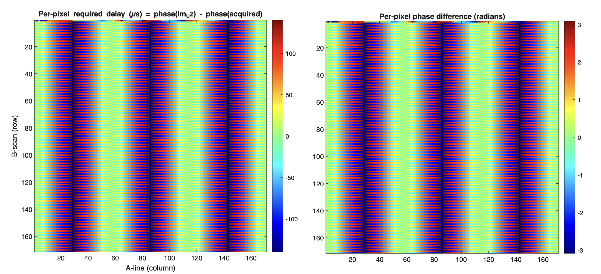
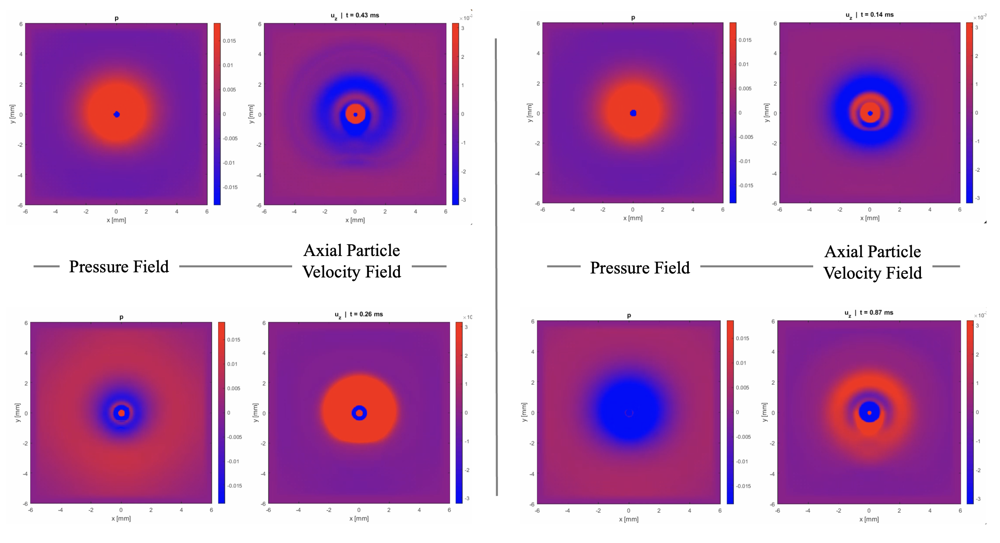
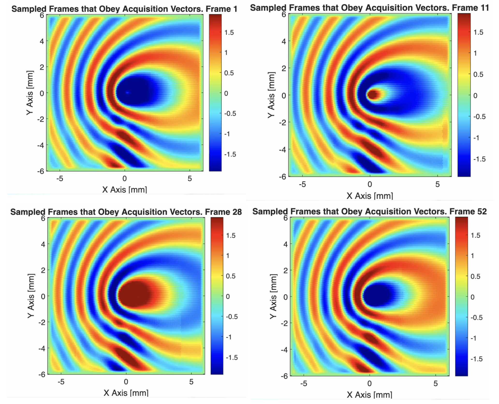

# SBM_Protocol_OCE: acquisition-protocol simulator for wave-based OCE

Simulation framework for the **Synchronized BM-Mode (SBM)** and **Multimeridian MB-mode** acquisition protocols for wave-based Optical Coherence Elastography (OCE), developed in the undergraduate thesis of **Estéfano Machado Ferrer**, under the supervision of Prof. Fernando Zvietcovich, PhD, at the Biophotonics and Biomedical Optics Research Group (GIBIO), Pontificia Universidad Católica del Perú.

> **Thesis:** E. Machado Ferrer, *Development of an Acquisition Protocol for Non-Cylindrical Wave Propagation in Wave-Based OCE*, PUCP, 2026. PDF: [`docs/`](docs/)

The framework simulates harmonic and quasi-harmonic shear/surface-wave propagation with k-Wave, samples the wavefield with the exact timing ("acquisition vectors") of each protocol, recovers the wavefield, and estimates phase-speed maps with 2D phase-gradient (PG) and total-variation-regularized PG (PG-TV) estimators, reporting accuracy, precision and CNR.

## Repository layout

```
SBM_Protocol_OCE/
├── Sampling_Acq_Sim_SBM_v4_Ideal.mlx                 SBM protocol, ideal (no eye motion)
├── Sampling_Acq_Sim_SBM_v4_Cylindrical_Ideal.mlx     SBM, cylindrical propagation case
├── Sampling_Acq_Sim_SBM_v4_Saccades.mlx              SBM with simulated saccades
├── SBM_Aux.mlx                                       SBM auxiliary calculations
├── Sampling_Acq_Sim_MB_v4_Ideal.mlx                  Multimeridian MB mode, ideal
├── Sampling_Acq_Sim_MB_v4_Saccades.mlx               Multimeridian MB mode with saccades
├── Sampling_Acq_Sim_MB_v4_*_Cylindrical_QH.mlx       MB mode, cylindrical quasi-harmonic cases
├── Codes/                 framework functions
│   ├── CustomMedium_*_kWave_Acoustic.m, Wave_Prop_Simulation_v3.m    wave propagation (k-Wave)
│   ├── AcqVectors_SBM*.m, AcqVectors_MultimeridianMB.m               acquisition vectors (scan timing)
│   ├── SamplingSim_fromAcqVecs*.m, Sampling_fromAcqVecs_Generalized.m  sampling of the wavefield
│   ├── Recovery_fromSampledFrames_SBM*.m                             SBM equivalent-time recovery
│   ├── Prepare_*_2DPhaseGradient*.m, PhaseGradient*.m, TVDenoise_ChambollePock2D.m   speed estimators
│   ├── Compute_*_Masks*.m, Get_*Mask*.m                              metrics and ROIs
│   └── Add_Saccades_*.m                                              eye-motion models
├── Batch_Simulations/     batch layer for the experiment-matched 18 x 18 mm study
│   ├── AcqSim_Config.m    single source of truth (medium, grid, estimator, run lists)
│   ├── Run_AcqSim_Batch.m → Analyze_AcqSim_Batch.m
│   └── display_helpers/   colormaps and plotting helpers
├── figures/               representative thesis results (see below)
└── docs/                  thesis manuscript (PDF)
```

## Requirements

- MATLAB R2026a (developed and tested).
- Signal Processing, Image Processing, Statistics and Machine Learning, and Curve Fitting toolboxes. Parallel Computing Toolbox is optional.
- [k-Wave](http://www.k-wave.org) MATLAB toolbox (LGPL-3.0, not included). Download it and place it at `Codes/k-Wave/`.

## Quick start

1. Clone the repository and install k-Wave in `Codes/k-Wave/`.
2. Set MATLAB's current folder to **the repository root** before running a live script. The first section adds `./Codes` and all its subfolders (including `Codes/k-Wave`) to the path, and results are written to `./Results`. The scripts change folder while saving results, so `cd` back to the repository root before running a script again.
3. Run a live script, e.g. `Sampling_Acq_Sim_SBM_v4_Ideal.mlx`. Each section is documented (simulation, acquisition vectors, sampling, recovery, PG and PG-TV estimation, metrics).
4. For the batch study, run `Batch_Simulations/Run_AcqSim_Batch.m`, then `Batch_Simulations/Analyze_AcqSim_Batch.m`. Outputs are written to `Results/` (ignored by git).

## Representative results

| | |
|---|---|
|  |  |
| Acquisition phase of every pixel for the scan protocol | Simulated non-cylindrical wave propagation (ground truth) |
|  |  |
| Sampled frames before phase compensation | Sampled frames after phase compensation |
|  |  |
| Recovered wavefield with SBM | Recovered vs. ideal phase |
|  |  |
| Phase-difference maps | Recovery without synchronization (for comparison) |

## Related repository

The acquisition-pattern generator, the LabVIEW integration and the processing pipelines used on the experimental Twin OCT (1300 nm SS-OCT) data are in **[OCE_Experimental_Protocols](https://github.com/emftech/OCE_Experimental_Protocols)**.

## Citation

If you use this code, please cite the thesis (and the corresponding journal articles once published):

```bibtex
@thesis{MachadoFerrer2026SBM,
  author = {Machado Ferrer, Estéfano},
  title  = {Development of an Acquisition Protocol for Non-Cylindrical Wave Propagation in Wave-Based OCE},
  school = {Pontificia Universidad Católica del Perú},
  year   = {2026},
  type   = {Undergraduate thesis}
}
```

## License

Code: MIT (see [LICENSE](LICENSE)). The thesis manuscript and figures are © the author, all rights reserved. k-Wave is distributed separately under LGPL-3.0.
