# OCE_AcquisitionProtocols_Simulator

A MATLAB simulation framework for designing and comparing **acquisition protocols for wave-based Optical Coherence Elastography (OCE)**. It covers the conventional and **Multimeridian MB mode** and the novel **Synchronized BM-mode (SBM)** protocol proposed in the thesis. It answers one question: *for a given scan pattern and timing, how well can the phase-speed (stiffness) map be recovered?*

> **About SBM:** the Synchronized BM-mode protocol is a **novel acquisition protocol** introduced in this thesis. It has **not yet been published** in a peer-reviewed journal. Please cite the thesis if you use or build on it.

Developed in the undergraduate thesis of **Estéfano Machado Ferrer**, under the supervision of Prof. Fernando Zvietcovich, PhD, at the Biophotonics and Biomedical Optics Research Group (GIBIO), Pontificia Universidad Católica del Perú.

> **Thesis:** E. Machado Ferrer, *Development of an Acquisition Protocol for Non-Cylindrical Wave Propagation in Wave-Based OCE*, PUCP, 2026. PDF: [`docs/Machado_2026_Thesis_Acquisition_Protocol_NonCylindrical_WaveBased_OCE.pdf`](docs/Machado_2026_Thesis_Acquisition_Protocol_NonCylindrical_WaveBased_OCE.pdf).
>
> This repository is **simulation only**. The hardware implementation on a real OCT system (scan-pattern generator, LabVIEW integration and processing of experimental data) is in the companion repository **[OCE_Experimental_Protocols](https://github.com/emftech/OCE_Experimental_Protocols)**.

## What the simulator does

```
 1. Wave propagation     k-Wave simulation of a harmonic or quasi-harmonic source in a custom 2D medium
                         (homogeneous / cylindrical, or with stiff inclusions / non-cylindrical)
          │
 2. Acquisition vectors  exact galvo X/Y positions and trigger timing of the chosen protocol,
                         on the OCT A-line clock (200 kHz)
          │
 3. Sampling             the wavefield is sampled where and when the OCT beam actually is,
                         optionally with eye motion (saccades)
          │
 4. Recovery             MB: per-meridian M-B frames  ·  SBM: equivalent-time recovery with
                         per-pixel acquisition-phase compensation
          │
 5. Speed estimation     1D PG along meridians, 2D phase gradient (PG), TV-regularized 2D PG (PG-TV)
          │
 6. Metrics              accuracy error Ea, precision error Ep and CNR in background and inclusion ROIs
```

### Protocols

| Protocol | Scan pattern | How the wave is captured |
|---|---|---|
| **Multimeridian MB mode** | M-B scans along N meridians through the excitation source | each meridian is an M-mode B-scan; the meridians are interpolated into an en-face map |
| **Synchronized BM mode (SBM)** (novel, unpublished) | ordinary raster BM scan, repeated over N_F frames | the scan is locked to the excitation so each frame samples every pixel at a slightly later phase; stacking frames reconstructs the 2D wavefield in equivalent time |

### Simulation cases

| Case | Medium | Excitation | Live scripts |
|---|---|---|---|
| Ideal | non-cylindrical (inclusions) | harmonic | `Sampling_Acq_Sim_MB_v4_Ideal.mlx`, `Sampling_Acq_Sim_SBM_v4_Ideal.mlx` |
| Cylindrical | homogeneous | harmonic (SBM), quasi-harmonic (MB) | `Sampling_Acq_Sim_SBM_v4_Cylindrical_Ideal.mlx`, `Sampling_Acq_Sim_MB_v4_Ideal_Cylindrical_QH.mlx` |
| Saccades | as above, plus simulated eye motion | harmonic / quasi-harmonic | `Sampling_Acq_Sim_MB_v4_Saccades.mlx`, `Sampling_Acq_Sim_SBM_v4_Saccades.mlx`, `Sampling_Acq_Sim_MB_v4_Saccades_Cylindrical_QH.mlx` |

`SBM_Aux.mlx` holds auxiliary SBM timing calculations.

## Repository layout

```
├── Sampling_Acq_Sim_*_v4_*.mlx   live scripts, one per protocol and case (documented step by step)
├── SBM_Aux.mlx
├── Codes/                        framework functions
│   ├── Wave_Prop_Simulation_v3.m, CustomMedium_{Harmonic,QuasiHarmonic}_kWave_Acoustic.m   wave propagation
│   ├── AcqVectors_MultimeridianMB.m, AcqVectors_SBM*.m                                     acquisition vectors
│   ├── SamplingSim_fromAcqVecs*.m, Sampling_fromAcqVecs_Generalized.m                      sampling
│   ├── Recovery_fromSampledFrames_SBM*.m                                                   SBM recovery
│   ├── Prepare_{MB,SBM}_2DPhaseGradient*.m, PhaseGradient*.m, TVDenoise_ChambollePock2D.m speed estimators
│   ├── Compute_{AccuracyError,PrecisionError,CNR}_Masks*.m, Get_*Mask*.m                   metrics and ROIs
│   └── Add_Saccades_*.m                                                                    eye-motion models
├── Batch_Simulations/            batch study matched to the experiments (18 x 18 mm, c = 10.54 m/s)
│   ├── AcqSim_Config.m           all parameters and run lists
│   ├── Run_AcqSim_Batch.m        runs every MB and SBM configuration
│   ├── Analyze_AcqSim_Batch.m    summary tables, metrics vs. meridians / B-scans, dispersion
│   └── display_helpers/
├── figures/                      representative thesis results
└── docs/                         thesis manuscript (PDF)
```

## Requirements

- MATLAB R2026a (developed and tested).
- Signal Processing, Image Processing, Statistics and Machine Learning, and Curve Fitting toolboxes. Parallel Computing Toolbox is optional.
- [k-Wave](http://www.k-wave.org) (LGPL-3.0, not included): download it and place it in `Codes/k-Wave/`.

## Quick start

1. Clone the repository and put k-Wave in `Codes/k-Wave/`.
2. Open a live script, for example `Sampling_Acq_Sim_SBM_v4_Ideal.mlx`, and run it section by section. The first section finds the repository folder, adds `Codes/` and its subfolders (including k-Wave) to the path, and results are saved under `Results/` (ignored by git). The current folder is never changed. If you run a script outside the Live Editor, set the current folder to the repository root first.
3. Scripts with `sim_opts.useGUI = true` open a GUI to define the medium (background speed, inclusions). The chosen medium is saved in your MATLAB preferences, and headless runs (`useGUI = false`) reuse it, or the default medium if none was saved.
4. For the batch study, run `Batch_Simulations/Run_AcqSim_Batch.m` and then `Batch_Simulations/Analyze_AcqSim_Batch.m`.

## Representative results

All figures are from the final thesis manuscript (chapter numbers in the file names). Simulations use a non-cylindrical medium with a low-speed elliptical inclusion; "saccadic" means simulated lateral eye motion during acquisition.

**Simulation framework**

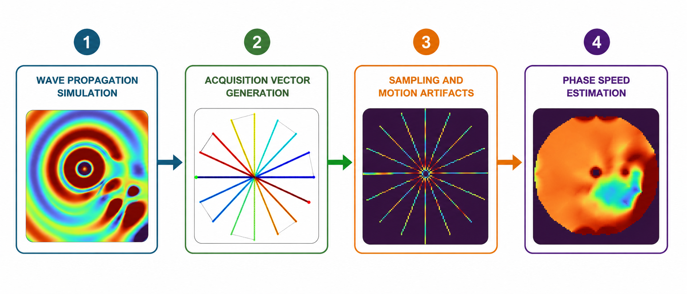

Wave propagation (k-Wave) → acquisition vectors → sampling, with optional motion artifacts → phase-speed estimation.

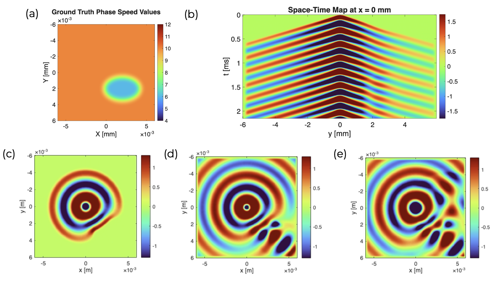

Non-cylindrical harmonic propagation: ground-truth speed map, space-time map and wavefield snapshots showing wavefront distortion and scattering at the inclusion.

**The SBM protocol**

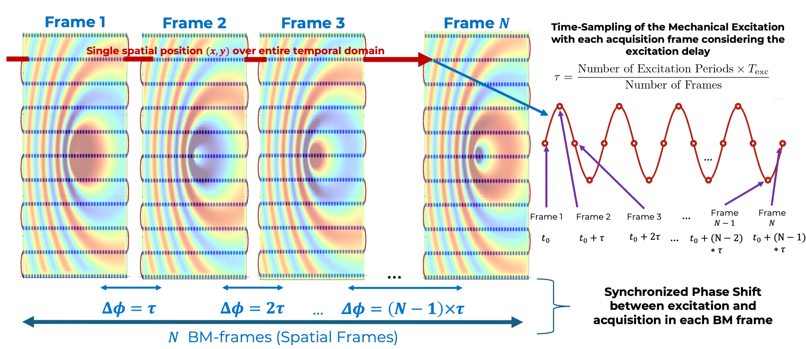

Consecutive raster BM frames are acquired with progressively increasing delays relative to the harmonic excitation. Stacking them reconstructs the temporal evolution at every pixel: MB-like temporal sampling with BM-like dense spatial sampling.

| | |
|---|---|
| 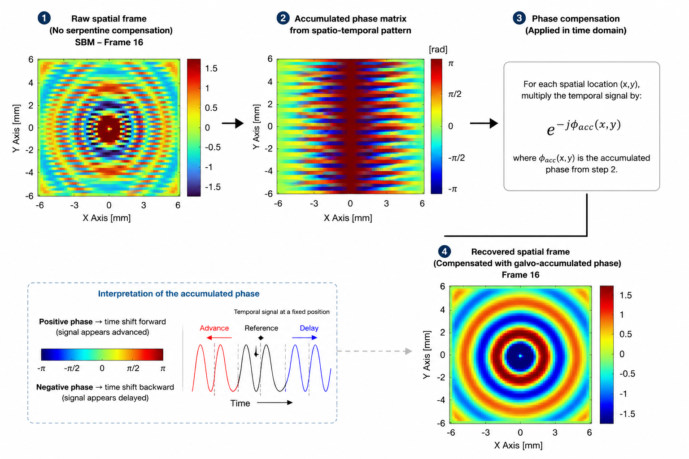 | 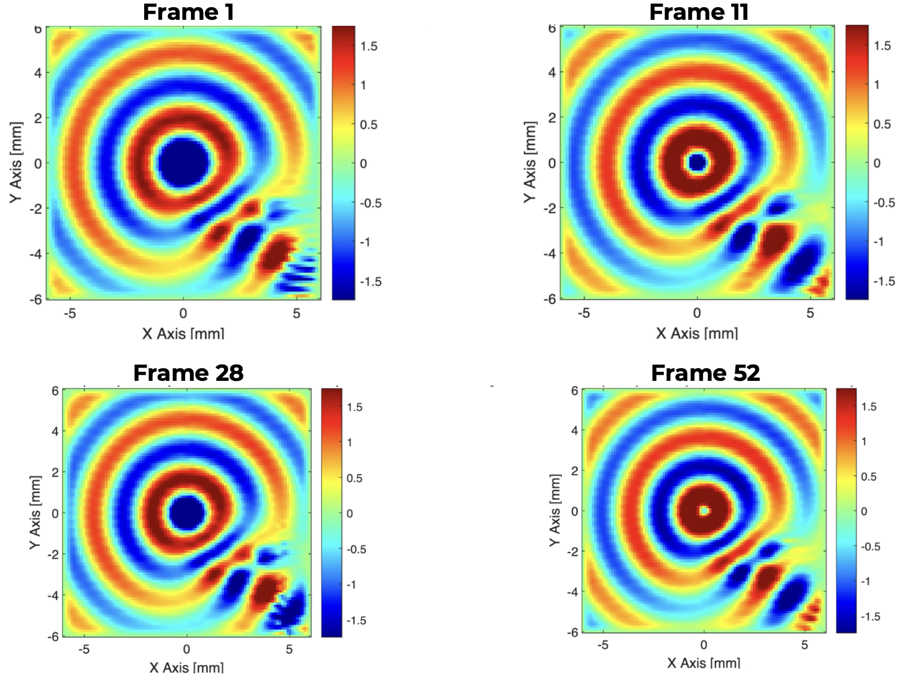 |
| Phase compensation: the raster-induced acquisition phase φ_acq(x, y) is removed pixel by pixel, restoring the wavefront | Recovered SBM frames for the non-cylindrical case, interpolated onto a 100 × 100 grid |

**Elastograms**

| | |
|---|---|
| 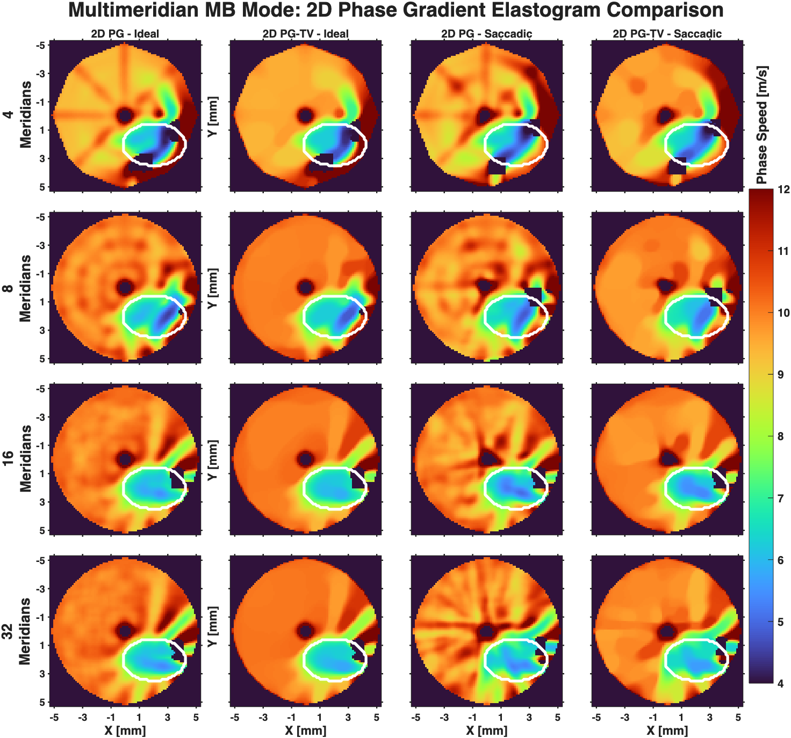 | 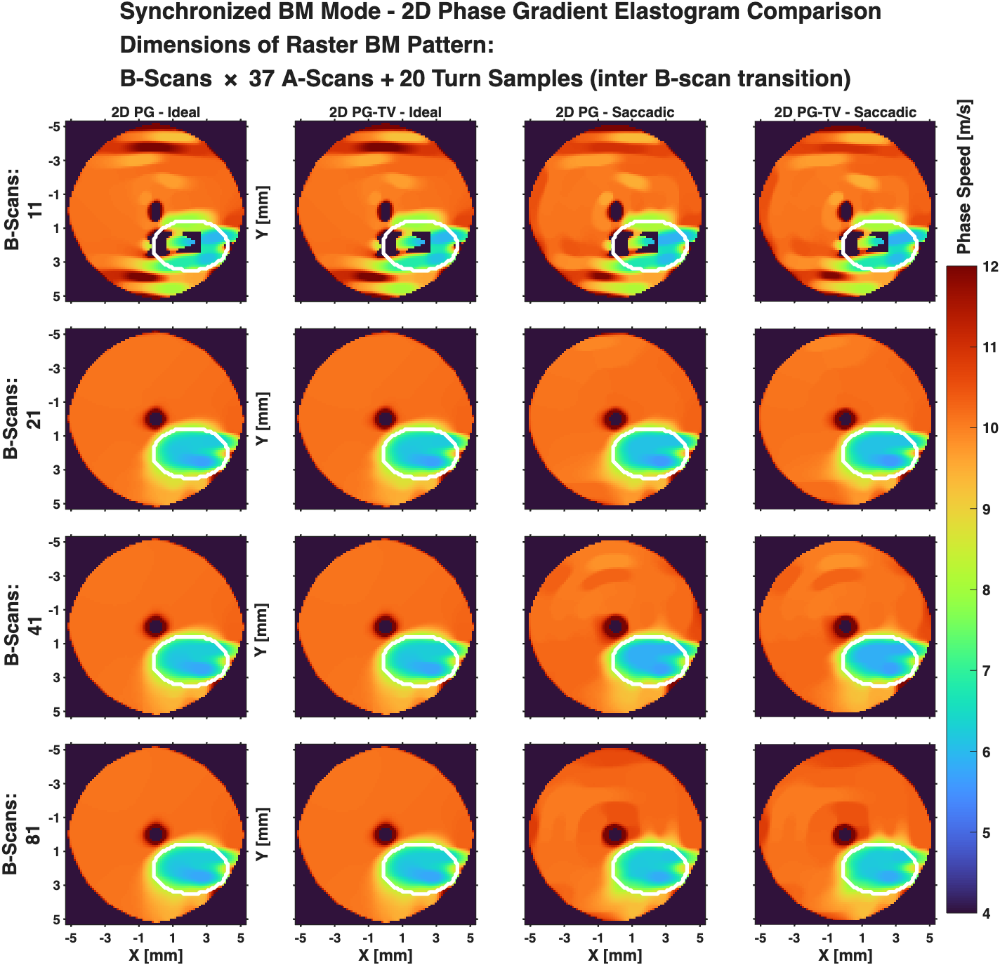 |
| Multimeridian MB mode, 2D PG and 2D PG-TV, ideal and saccadic, for 4, 8, 16 and 32 meridians | SBM, 2D PG and 2D PG-TV, ideal and saccadic, for 11, 21, 41 and 81 B-scans |

**MB vs. SBM comparison**

| | |
|---|---|
| 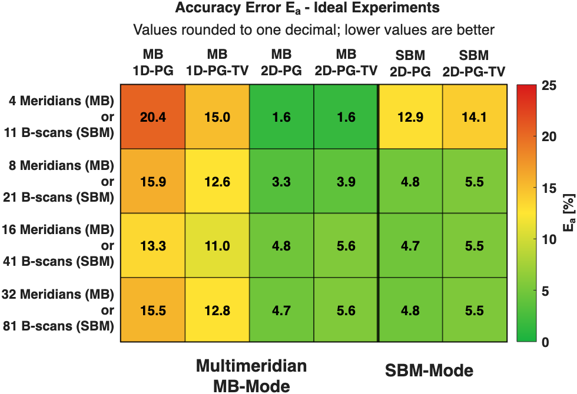 | 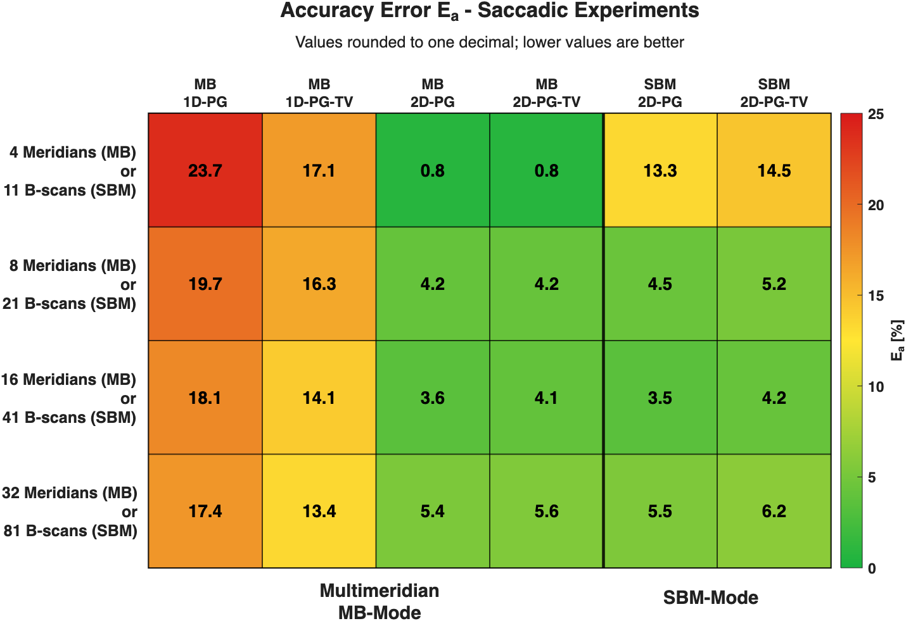 |
| Global accuracy error E_a, ideal acquisition | Global accuracy error E_a, with saccades: the 2D estimators stay accurate while the 1D ones degrade |
| 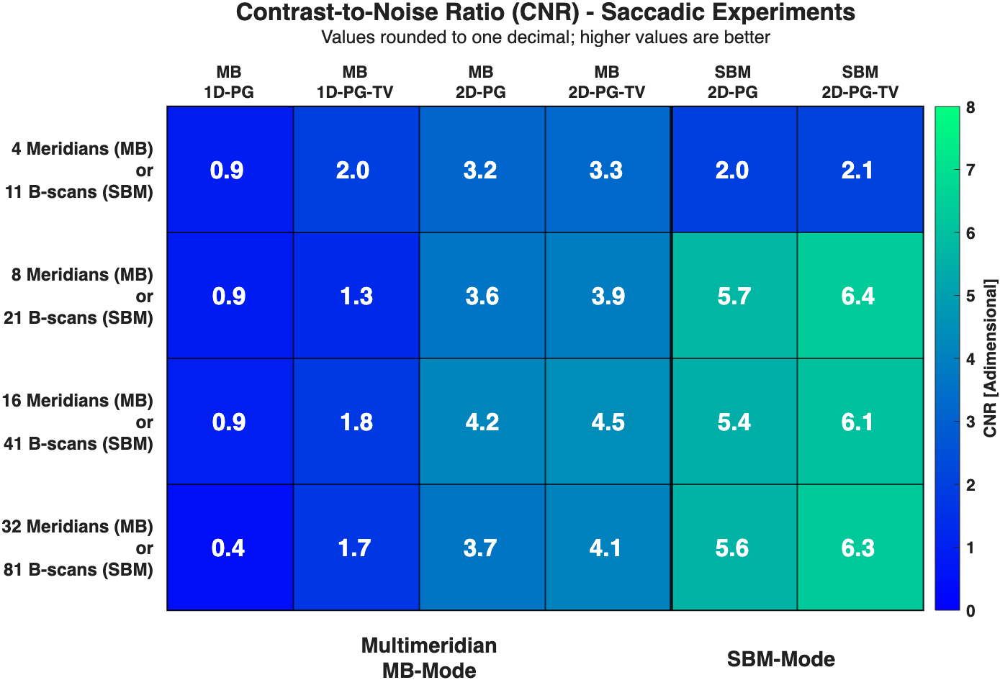 | 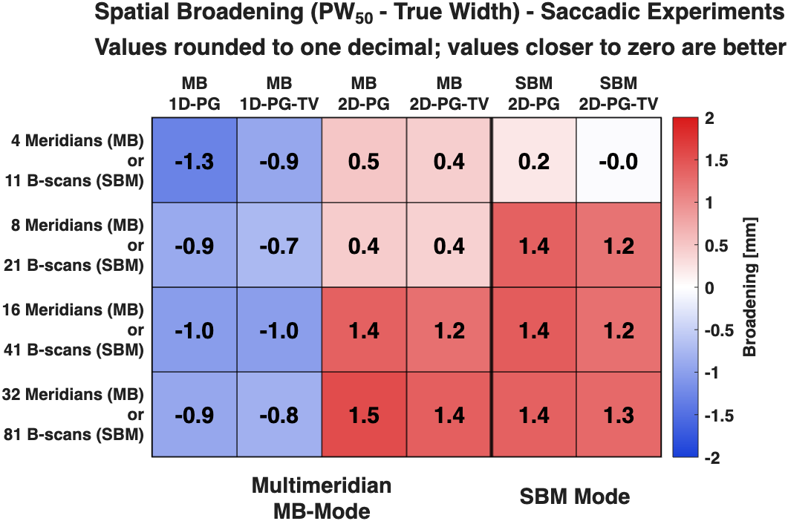 |
| Contrast-to-noise ratio with saccades: SBM keeps high CNR and outperforms MB | Inclusion-width broadening (PW50 − W_true) with saccades: SBM with 21 B-scans is comparable to denser rasters at a much shorter acquisition time |

Full results, including precision error, spatial resolution and the ideal-case CNR, are in the thesis.

## Citation

If you use this code, please cite the thesis (and the corresponding journal articles once published):

```bibtex
@thesis{MachadoFerrer2026SBM,
  author = {Machado Ferrer, Estéfano},
  title  = {Development of an Acquisition Protocol for Non-Cylindrical Wave Propagation in Wave-Based OCE},
  school = {Pontificia Universidad Católica del Perú},
  year   = {2026},
  type   = {Undergraduate thesis}
}
```

## License

Code: MIT (see [LICENSE](LICENSE)). The thesis manuscript and figures are © the author, all rights reserved. k-Wave is distributed separately under LGPL-3.0.
